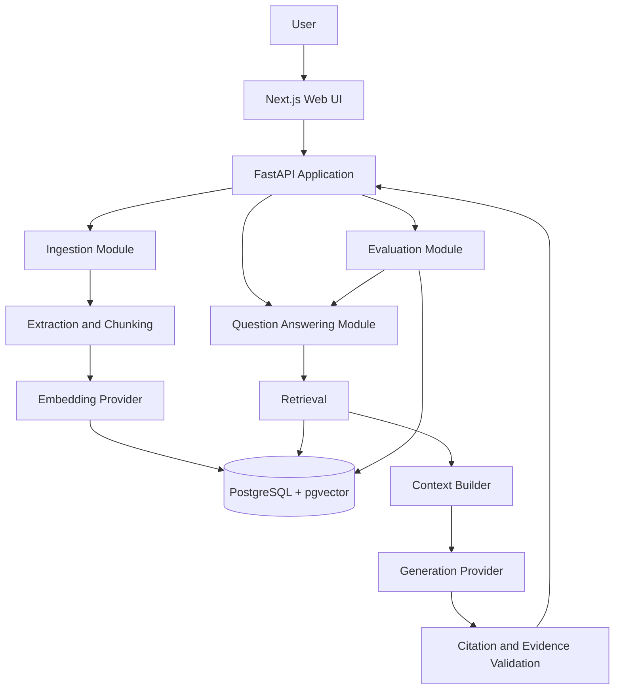

# EvidenceDesk — System Architecture

**Status:** Initial architecture baseline
**Version:** 0.1.0
**Architecture style:** Modular monolith, local-first

## 1. Architectural goals

- Keep the initial system understandable and deployable as one application.
- Separate domain logic, application workflows, infrastructure, and API presentation.
- Make ingestion, retrieval, generation, and evaluation independently testable.
- Keep model and embedding providers replaceable.
- Preserve traceability from an answer to its retrieved source passages.
- Avoid premature services and dependencies.

## 2. High-level system

The initial deployment consists of a web frontend, a Python API, PostgreSQL with pgvector, and optional background processing when ingestion workload justifies it.

This is a logical diagram. It does not imply that every module or optional service has already been implemented.

## 3. Technology boundaries

### Web application

Responsibilities:
- Document upload and processing-status display.
- Question entry and answer display.
- Citation inspection and source navigation.
- Evaluation run initiation and results display when implemented.

The browser must not receive database credentials or hosted-model API keys.

### API layer

Responsibilities:
- Validate requests and responses.
- Apply authentication and authorization when introduced.
- Call application services.
- Translate known failures into safe HTTP responses.
- Expose health and readiness information appropriate to the deployment.

API route handlers must not contain the core retrieval, ingestion, or evaluation algorithms.

### Application and domain modules

Responsibilities:
- Orchestrate use cases.
- Enforce product rules.
- Define the data needed by each workflow.
- Keep core behavior independent of HTTP and provider-specific SDKs where practical.

Initial logical modules:
- Documents and ingestion.
- Chunking and embeddings.
- Retrieval.
- Question answering and citations.
- Evaluation.
- Configuration and operational health.

These are logical boundaries, not a requirement to create a large number of tiny files.

### Infrastructure adapters

Responsibilities:
- PostgreSQL persistence and vector search.
- File storage.
- Embedding and generation provider integrations.
- Background job execution when introduced.
- Logging and operational instrumentation.

Provider-specific details must not leak throughout the domain logic.

## 4. Ingestion flow

1. Receive a document through the API.
2. Validate the file type, size, and permitted storage behavior.
3. Assign a stable document identifier and record its processing state.
4. Extract text and useful structural metadata.
5. Normalize extracted content without destroying meaningful structure.
6. Split content into configurable chunks.
7. Record each chunk's document association and source metadata.
8. Generate embeddings through the configured embedding provider.
9. Persist document, chunk, and embedding records.
10. Mark the document as ready or failed with a safe, diagnosable error.

Processing must not mark a document ready before its searchable data is usable. Repeated processing must not silently create duplicate active records.

Initial chunking parameters are configuration, not permanent constants. Begin experiments around 500 tokens per chunk and 75 tokens of overlap, then evaluate alternatives.

## 5. Question-answering flow

1. Validate the question and establish the authorized document scope.
2. Create a query embedding using the compatible configured model.
3. Retrieve candidate chunks from the permitted collection.
4. Record the retrieval configuration and candidate identifiers needed for diagnostics.
5. Apply any enabled ranking or reranking stage.
6. Construct a bounded context from selected evidence.
7. Ask the configured generation provider for a grounded response with structured source references.
8. Validate that returned source references point to actual retrieved passages.
9. Assess evidence sufficiency and abstain when the configured policy requires it.
10. Return the answer, citations, and appropriate uncertainty information.

A valid citation reference does not automatically establish that a passage supports a claim. Citation-support validation must be evaluated separately.

## 6. Retrieval evolution

### Baseline

Start with dense vector retrieval and a measured top-k configuration.

### Controlled improvements

Add only after the baseline is tested:
- Lexical retrieval using PostgreSQL full-text search.
- Rank fusion such as Reciprocal Rank Fusion.
- Optional cross-encoder reranking.
- Configurable retrieval and context limits.

Do not describe PostgreSQL full-text search as exact BM25 unless an actual BM25 implementation is introduced.

Every experiment must record its dataset version, retrieval settings, model identifiers, and relevant software version.

## 7. Evaluation architecture

The evaluation module must be distinct from ordinary user-facing question answering.

Each evaluation case should support:
- A question.
- The expected answer or acceptable answer criteria.
- Expected supporting document and chunk identifiers where available.
- Whether the question is answerable from the supplied collection.

Measure retrieval quality separately from generated-answer quality.

Candidate metrics include:
- Recall@k.
- Mean Reciprocal Rank.
- nDCG where relevance grades are available.
- Citation-support rate on a reviewed sample.
- Abstention precision and recall.
- Latency and cost where measurable.

Maintain a fixed baseline dataset for regression comparisons. Store the relevant configuration and results so comparisons can be reproduced. Treat model-based judges as fallible.

## 8. Persistence model

The planned PostgreSQL schema will evolve through reviewed migrations.

Initial conceptual entities:
- Document: identity, filename or safe display name, content hash, processing state, timestamps, and version information.
- Chunk: document association, chunk index, extracted text, structural metadata, and embedding.
- Evaluation dataset and case: versioned questions, expected evidence, and answerability labels.
- Evaluation run and result: configuration, metrics, outcomes, and timestamps.

Workspace and user associations must be designed before multi-user access is enabled. Authorization must be enforced in backend queries, not merely in the UI.

The final schema will be defined separately and implemented through migrations. This conceptual list is not a database migration.

## 9. Background processing

Begin with the simplest implementation that meets ingestion requirements.

Introduce a worker and queue when processing latency, reliability, or workload justifies them. If introduced, use bounded retries, explicit job states, idempotent operations, and safe failure reporting.

Redis and Celery are planned options, not mandatory services for the first health-check milestone.

## 10. Security boundaries

- Treat uploaded files, extracted text, and retrieved passages as untrusted.
- Keep provider credentials server-side.
- Validate uploads and enforce resource limits.
- Prevent path traversal and unsafe filesystem operations.
- Use parameterized database access.
- Restrict retrieval to the authorized collection.
- Prevent untrusted document instructions from overriding system behavior.
- Avoid logging secrets or unnecessary document contents.
- Define deletion semantics for originals, chunks, embeddings, and derived records.

Detailed threats, assumptions, and mitigations belong in `docs/security/THREAT_MODEL.md`.

## 11. Configuration and provider interfaces

Configuration should be validated at application startup.

Separate configuration for:
- Database connection.
- Storage location and upload limits.
- Embedding provider and model.
- Generation provider and model.
- Retrieval parameters.
- Logging and development behavior.

The embedding model used to create indexed vectors must remain compatible with the model used for queries. Model changes that affect vector dimensions or embedding semantics require an explicit re-embedding and migration strategy.

Never store real credentials in `.env.example`.

## 12. Observability and failure handling

Use structured logs and request identifiers where practical.

Track relevant stages and durations:
- Extraction.
- Chunking.
- Embedding.
- Retrieval.
- Reranking.
- Generation.
- Evidence validation.

Return safe errors to clients while retaining enough non-sensitive diagnostics for developers. Add readiness checks, recovery procedures, and performance targets as the system matures.

## 13. Testing strategy

- Unit-test chunking, validation, ranking, and evidence-handling logic.
- Integration-test persistence and vector search.
- Test ingestion failures, duplicate submissions, and deletion.
- Test insufficient-evidence questions and invalid citations.
- Test authorization boundaries before multi-user deployment.
- Keep a deterministic mock-provider path for fast automated tests.
- Run end-to-end tests for the main user workflow when the frontend exists.

Tests must not require paid services or real credentials by default.

## 14. Deployment model

The first target is local development using documented commands and Docker Compose.

The architecture should allow a later deployment to a private environment, but cloud deployment is not part of the first milestone. Any hosted release requires a separate review of authentication, TLS, secrets, storage isolation, backups, monitoring, and incident response.

## 15. Architectural decision process

For each significant change:
1. State the problem and constraints.
2. Compare realistic alternatives.
3. Explain trade-offs and operational cost.
4. Choose the smallest option that meets the requirement.
5. Record decisions that materially affect module boundaries, data formats, security, or deployment.

Do not introduce an abstraction or service solely because it may be useful someday.
